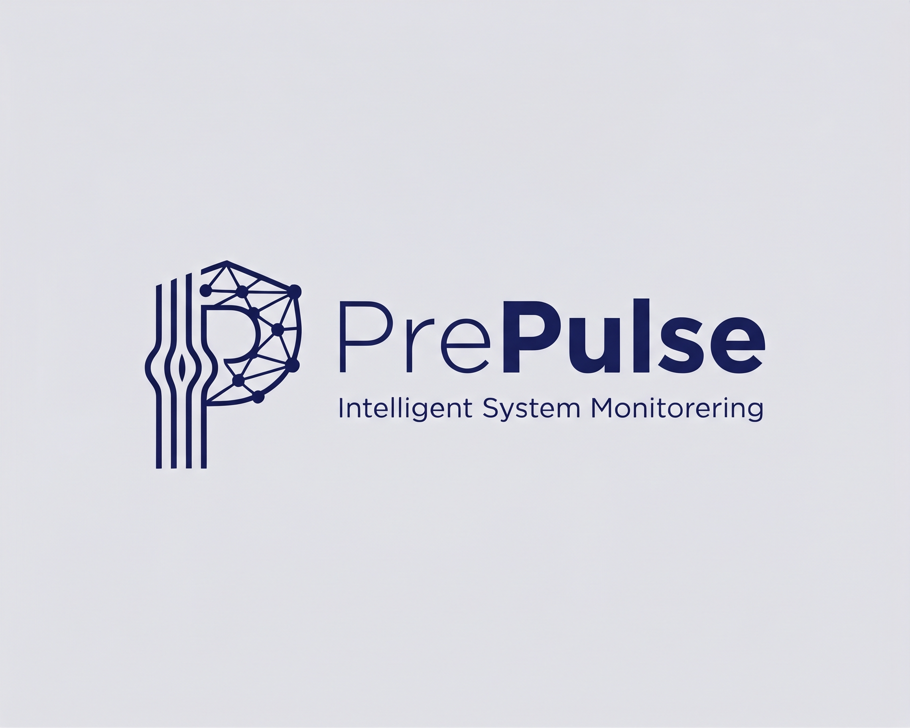

  

# PrePulse Backend (Inception Phase)

This is the backend architecture for **PrePulse**, developed as a major project in collaboration with Preface.

**Status:** The project is in the initial setup phase. Architecture and core functionalities are currently being defined.

## Technologies
* **Language:** Python

## Purpose
To build a robust backend system focused on system monitoring, log analysis, and integrated IT security measures.

## Project Team & Collaboration

This project is developed as a major project in collaboration with **Preface**.

**Team Members (Students):**
*   **Najib Nawabi** (GitHub: [@CodeByNajib](https://github.com/CodeByNajib))
    *   Email (Student): `nana0001@stud.ek.dk`
    *   Email (Personal): `jivonajib1990@gmail.com`
*   **Marcus Lieber Heilstrup** (GitHub: [@MarcusLieberH](https://github.com/MarcusLieberH))
    *   Email (Student): `mahe0009@stud.ek.dk`
    *   Email (Personal): `marcus.heilstrup98@gmail.com`

**Product Owner (Preface):**
*   **Christian Rasmussen**
    *   Title: Partner / IT Chef
    *   Email: `kontakt@preface.dk`

## Getting Started
This project is currently under active development. Further instructions for setup and deployment will be added as the project progresses.
